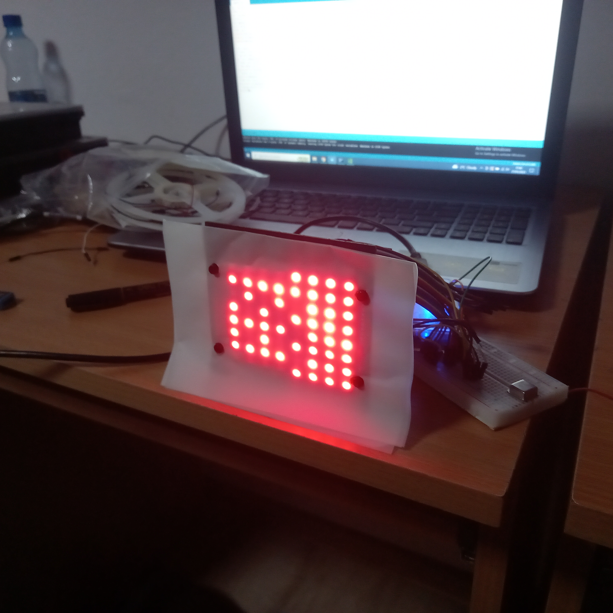
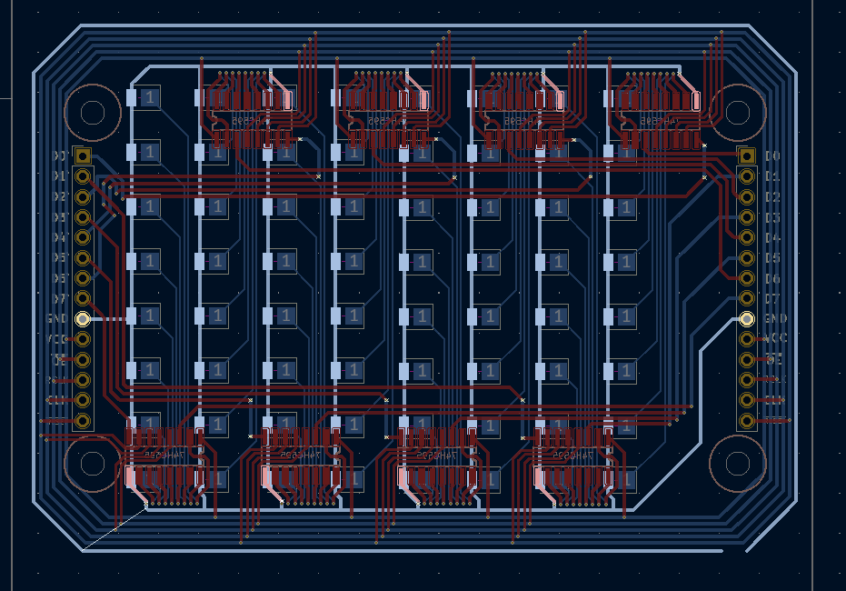

# LED_MATRIX ⛔ Discontinued

## Description:
 An 8x8 matrix of 3528 SMD led\`s  controlled with [74HC595](https://www.diodes.com/assets/Datasheets/74HC595.pdf) shift registers witch can be chained one with another and create text, paterns, images and more. A more [compact design](./LedMatrix_Pictures/2.png) is recomended for whoever wants to make something like this.

## Testing and results
The first version has some mistakes and can\`t be chained or controlled propperly. I put a difused sheet of paper to make the ligth smoother and even.

## License

This project and its subprojects are licensed under
the [MIT License](LICENSE).

